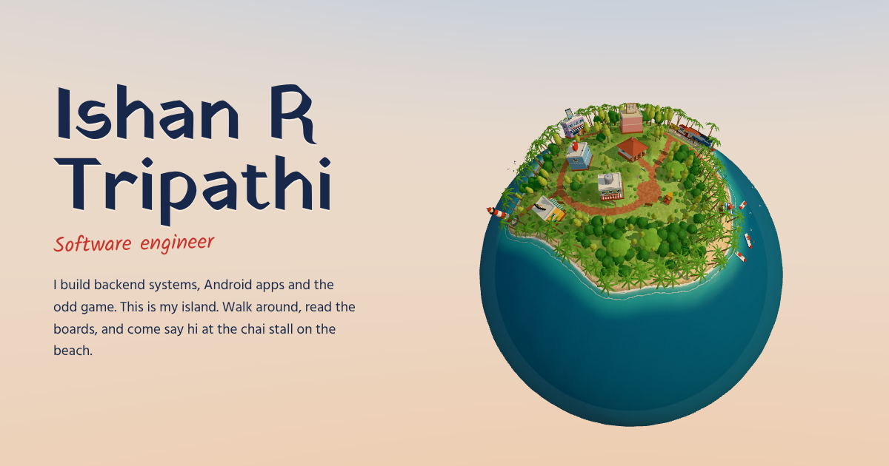

# ishanr.com

My portfolio as a small island you can walk around. You come out of my studio, wave hi, follow the red path past one building per project, ride the scooter if you like, check the departures board at Ishan Junction for my career, and end at a chai stall on the beach where I sit down and wave you over.

Every board opens a letter about the project. "Page view" shows everything as a plain page, for anyone who'd rather read than walk (and for browsers without WebGL).



## Run it

```bash
npm install
npm run dev      # http://localhost:5173
npm run build    # checks the island, then builds to dist/
```

Pushing to `master` deploys to GitHub Pages at ishanr.com (`.github/workflows/main.yml`).

Controls: WASD or arrow keys to walk, Shift to run, E to ride the scooter, Enter to read a board, drag to look around. On phones, a joystick appears bottom left.

## Change the content

Everything people read is in [`src/content.js`](src/content.js): intro, projects, career stops, achievements and links. Add a project there and it gets a building and a board on the path. The building style comes from its `building` field (`tiffin`, `calculator`, `clock`, `phone`, `arcade`).

If you move things around in [`src/world/layout.js`](src/world/layout.js), run `npm run check`. It fails if a building, tree or board ends up on a path or in the sea, and it runs before every build.

## Make real 3D models with Tripo

The world ships with low-poly models built in code. The Tripo pipeline swaps them for generated models, including a rigged and animated character made from your photos.

1. Get an API key at [developers.tripo3d.ai](https://developers.tripo3d.ai/) and put it in `.env.local` (git ignores it):
   ```
   TRIPO_API_KEY=tsk_...
   ```
2. Fill in the `[brackets]` in [`tripo/jobs.mjs`](tripo/jobs.mjs) (how you look, what you wear) and add two photos: `tripo/photos/headshot.jpg` and `tripo/photos/fullbody.jpg` (also ignored by git).
3. Look at the dry run. It shows every step and what it costs, and spends nothing:
   ```bash
   npm run tripo
   ```
4. Make the images, then look at them in `tripo/out/<job>/`:
   ```bash
   npm run tripo -- run tiffin --yes
   ```
   A bad image means a bad model, so the pipeline stops after each image. If it is good, approve it and run again to make the 3D model. If not, ask for a new one:
   ```bash
   npm run tripo -- approve tiffin
   npm run tripo -- run tiffin --yes
   npm run tripo -- redo tiffin image
   ```
5. Shrink the results for the web (simplified mesh, WebP textures, meshopt). The model tools are optional dependencies, so `npm install` already added them locally:
   ```bash
   npm run models:optimize
   ```

Finished models land in `public/models/` and are listed in `public/models/manifest.json`; the world loads them in place of the stand-ins. If one comes in facing the wrong way, set its `yaw` there (in radians, `3.1416` turns it around). Task ids are kept in `tripo/state.json`, so finished steps are never paid for twice.

Notes:
- Everything uses one style line (`STYLE` in `tripo/jobs.mjs`) so the models look like one world.
- The character uses Tripo's v1.0 rig because it is the one with wave and sit animations. The newer v3.0 rig (`MODELS.rig`) is better for humanoids but only has idle, walk and run.
- Walk and run clips play at a rate matched to the walking speed. If feet slide, tune `walkStride` and `runStride` on the character in the manifest.

## How it's built

Three.js and Vite, no framework.

- `src/core/geo.js`: the island is laid out on a flat map and wrapped onto a small planet. Everything is placed with map coordinates.
- `src/world/`: terrain, sea, sky, trees (instanced, swaying in the wind), buildings, signs, birds, scooter.
- `src/player/`: the character, walking and riding, and the follow camera.
- `src/ui/`: title, letters, page view, touch controls.

To keep it at 60 fps, repeated things are instanced, buildings behind the planet's curve are not drawn, and the resolution drops automatically if the frame rate does.
